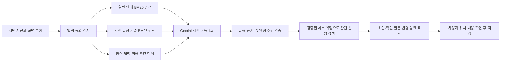

# 사진 제보 세부 유형 RAG (2026-11-24)

사용자가 제공한 RAG 영상의 확인 범위와 적용 판단은 [영상 검토 기록](RAG_VIDEO_REVIEW_20261124.md)에 적었다.

## 목표와 구조

K-ROAD가 현재 지원하는 생활불편·도로·안전재난의 **12개 구체 유형**, `no_issue`, 분야별 기타 3종의 구분 기준을 검색 가능한 제품 문서로 분리했다. 문서는 실제 사진에서 관찰할 단서, 유사 유형의 제외 조건, 추가 질문이 필요한 조건을 담는다. 이 기준은 앱의 분류 정책이며 공공기관의 공식 민원 분류나 사진의 진실 자체가 아니다.

`services/api/src/knowledge/photo-classification.json`은 전체 유형 개요, 정상 사진, 경계 사례, 유형별 카드로 구성된다. `retrievePhotoTaxonomy`는 작은 분류집 13개 문서 전체를 검색 점수 순으로 제공한다. 사용자가 보고 있던 분야의 카드를 앞에 놓되 다른 분야의 카드도 빠뜨리지 않는다. 화면 분야는 검색 문맥이며 최종 정답으로 취급하지 않는다. 후속 질문에서는 이전 사진의 관찰 문구도 검색어에 포함된다. 일반 안전·동의 문서, 유형 기준, 법령 적용 조건은 병렬로 읽어 한 번의 Gemini 호출에 제공한다.

모델은 사진과 검색 문서를 함께 받아 관찰을 먼저 작성하고, 관련 문서의 양성·제외 조건을 비교해 분야와 유형을 제안한다. 사용한 문서 ID만 `sourceIds`에 적고 서버가 실제 검색 결과에 있는 ID인지 검사한다. 검색 문서가 사진에 없는 파손이나 법적 위반을 증명할 수 없으며, 모델이 제보를 자동 게시하지 않는다. 기타 유형의 자동 확정, `road_report/none` 조합, 근거 ID 위조는 서버에서 거부한다.

## 실호출 확인

비교 기준은 [기존 사진별 평가](PHOTO_CLASSIFICATION_EVAL_20261124.md)의 2차 사진 13장이다. 유형 기준 RAG를 붙인 뒤 **같은 사진**을 다시 호출한 결과, 13건 모두 응답했고 유형 13/13, 유형과 초안 준비 여부 11/13이 사전 정답표와 일치했다. 정상 응답 p50/p95는 2.756/12.840초였다. 가로등과 얕은 침수 사진에서 유형은 맞았지만 추가 확인 필요 여부가 정답표와 달랐다. 같은 사진을 재사용했고 공급자 응답에도 변동이 있으므로 이 차이를 RAG의 정확도 향상으로 확정할 수 없다.

사용자가 **다른 분야 메뉴**에서 사진을 올리는 조건 6건도 시험했다. 5건은 응답하여 실제 사진의 분야·유형·초안 준비 여부가 일치했고, 침수 1건은 공급자 503으로 실패했다. 정상 응답의 p50/p95는 2.882/15.617초였다. 가드레일 사진에서는 모델이 `photo-facility`와 `photo-rockfall` 문서 ID를 인용하면서 안전 시설 유형을 선택했다. 해당 사진들도 이전에 본 사진이므로 독립 정확도 표본으로 합산하지 않는다. 이 두 시험은 전체 13개 카드 제공 변경 *이전*에 실행했다.

이전에 쓰지 않은 사진 2장에서는 침수 1건이 정답표와 일치했지만, 보행 신호등 1건을 `no_issue`로 잘못 분류했다. 이에 신호등 기준을 보강하고 전체 분류 카드를 제공하도록 변경했다. 변경 뒤 신호등 사진을 다시 호출하자 유형은 맞았으나 초안 준비 여부는 정답표와 달랐다. 또 다른 새 신호등 사진 1장은 유형과 준비 여부가 모두 일치했으며 응답 시간은 10.468초였다. 보강 뒤 **독립 새 사진 검증은 1장뿐**이다. 이 기록으로 모든 분야의 정확도 향상이나 속도 개선을 입증할 수 없다. 각 호출의 기대값·관측값·응답 시간·공급자 오류는 `docs/evaluation/photo-20261124/`의 `rag-*` 원시 파일에 있다.

13개 분류 카드와 **판독 후 법령 링크**를 적용한 뒤 기존 2차 사진 13장을 다시 호출했다. 12건 응답 중 유형 12/12, 유형과 초안 준비 여부 동시 일치 9/12였고, 차량 사진 1건은 공급자 오류(`AI_UNAVAILABLE`)였다. 성공 응답 p50/p95는 2.694/17.553초다. 가로등·침수·안전 시설 3건에서 `ready=false`로 보수적으로 보류해 사전 정답표의 `ready=true`와 달랐다. 이 사진은 수정 과정에 사용한 기존 자료이므로 독립 정확도 측정으로 보지 않는다. 원시 결과는 `rag-final-full-recheck-results.jsonl`에 있다.

### 법령 판독 전 제공 후 실호출 재검증

사용자가 제공한 API 인증값으로 현행 조문 10개를 동기화한 뒤 동일한 기존 2차 사진 13장을 다시 평가했다. 첫 `gemini-3.8-flash` 실행은 8건 성공, 근거 ID 오류 4건, 429 한 건이었다(`law-preinference-live-results.jsonl`). 모델이 법령 ID를 사진 근거 ID에 섞은 사례를 확인해 법령 내부 ID를 모델 문맥에서 제외했다. 다음 실행에서 공급자 503이 3건 연속 발생해 13건 전체 평가를 중단했다(`law-preinference-v2-results.jsonl`; 완료된 3건만 기록). 이들은 분류 오답으로 계산하지 않는다.

`gemini-3.5-flash-lite`로 같은 13장을 실행한 결과 **12/13건 응답**했고, 응답 12건 중 유형은 **12/12**, 유형과 초안 준비 여부는 **11/12**가 사전 정답표와 일치했다. 전체 요청을 분모로 보면 각각 12/13, 11/13이다. 침수의 `ready` 판단 한 건이 달랐고 안전 시설 한 건은 법령 제목을 사진 근거 ID에 포함해 거절됐다. 성공 응답 시간 p50/p95는 **2.862/10.025초**다(`law-lite-full-results.jsonl`). 이후 확인된 법령 제목을 사진 근거 ID에서 분리하도록 수정했다. 문제였던 안전 시설 사진과 기존에 별도로 사용했던 신호등·침수 사진 3장을 재검사한 결과 **3/3 응답, 유형 3/3, 유형과 준비 여부 1/3**, p50/p95 **2.848/3.395초**였다(`law-lite-postfix-results.jsonl`). 신호등·침수 두 건은 유형은 맞고 `ready=false`로 보류했다. 이 사진은 이전 개발·평가에 사용한 자료이므로 독립 정확도 추정치가 아니다. 휴대폰 촬영·업로드 시간은 측정하지 않았다.

## 관련 생활 법규

`services/api/src/knowledge/regulations.json`에 국가법령정보센터에서 2026-11-24 확인한 **10개 조문**을 담았다. 지원하는 12개 구체 사진 유형마다 최소 1개 이상의 조건부 관련 조문이 있다. 서버는 Gemini 판독 **전에** 모든 조문의 요약과 적용 조건을 `regulatoryContext`로 제공한다. 모델은 사진에서 관찰 가능한 사실과 조문의 적용 조건을 비교해 유형과 확인 질문을 제안한다. 판독 후에는 선택된 유형에 연결된 조문을 `legalReferences`로 반환하고 웹에 원문 링크와 적용 조건을 표시한다. 별도 Gemini 호출은 없다. 법령은 사진의 시각적 증거가 아니며 사진·서비스 문서의 인용 ID와 구분한다.

| 유형 | 연결한 조문 | 사용 범위 |
| --- | --- | --- |
| 흩어진 쓰레기·폐기물 더미 | [폐기물관리법 제8조](https://www.law.go.kr/LSW/lsLinkCommonInfo.do?lsJoLnkSeq=1021867493), [제15조](https://law.go.kr/lsLinkCommonInfo.do?lsJoLnkSeq=1022324597) | 배출 장소·방법을 확인할 때 참고. 사진만으로 무단투기 판정 불가 |
| 가로등 | [도로법 제31조](https://www.law.go.kr/LSW/lsLinkCommonInfo.do?chrClsCd=010202&lsJoLnkSeq=1033533375), [시행령 제3조](https://www.law.go.kr/lsLinkCommonInfo.do?lsJoLnkSeq=1029242727) | 도로관리청이 설치한 도로 부속물인지 확인 |
| 공원 시설 파손 | [공원녹지법 제19조](https://www.law.go.kr/LSW/lsLinkCommonInfo.do?chrClsCd=010202&lsJoLnkSeq=1026069705) | 법상 도시공원 시설인 경우에만 참고 |
| 포트홀·노면 파손 | [도로법 제31조](https://www.law.go.kr/LSW/lsLinkCommonInfo.do?chrClsCd=010202&lsJoLnkSeq=1033533375), [제76조](https://www.law.go.kr/lsLinkCommonInfo.do?chrClsCd=010202&lsJoLnkSeq=1033532989) | 유지·관리와 위험 시 통행 제한의 권한. 실제 통제는 별도 확인 |
| 도로 장애물 | [도로법 제75조](https://www.law.go.kr/LSW/lsLinkCommonInfo.do?chrClsCd=010202&lsJoLnkSeq=1029455869), [제76조](https://www.law.go.kr/lsLinkCommonInfo.do?chrClsCd=010202&lsJoLnkSeq=1033532989) | 누가 장애물을 쌓았는지 사진으로 단정하지 않음 |
| 차량 사고·파손 정황 | [도로교통법 제54조](https://www.law.go.kr/LSW/lsLinkCommonInfo.do?chrClsCd=010202&lsJoLnkSeq=1032547231) | 실제 교통사고가 확인된 경우의 조치. 파손만으로 사고 확정 불가 |
| 침수·결빙 의심·낙석 | [도로법 제31조](https://www.law.go.kr/LSW/lsLinkCommonInfo.do?chrClsCd=010202&lsJoLnkSeq=1033533375), [제76조](https://www.law.go.kr/lsLinkCommonInfo.do?chrClsCd=010202&lsJoLnkSeq=1033532989) | 해당 도로의 관리와 위험 시 통행 제한 가능성. 실시간 통제 아님 |
| 관리 대상 급경사지의 낙석 | [급경사지법 제5조](https://law.go.kr/LSW/lsLinkCommonInfo.do?chrClsCd=010202&lsJoLnkSeq=1025098563) | 관리 대상 급경사지인지 별도 확인 |
| 신호기·안전표지·도로 부속물 | [도로교통법 제3조](https://law.go.kr/lsLinkCommonInfo.do?chrClsCd=010202&lsJoLnkSeq=1031688429), [도로법 시행령 제3조](https://www.law.go.kr/lsLinkCommonInfo.do?lsJoLnkSeq=1029242727) | 신호기·표지와 가드레일 등 시설을 구별해 적용 |

폐기물 배출 시각·장소는 관할 지자체 조례와 시설 관리자 지정 방법에 따라 달라진다. 위치 좌표만으로 관할과 현행 조례를 확정하는 기능은 아직 없다. 따라서 특정 시·군의 배출 규칙을 강원 전역에 적용하지 않았다. 법령 안내는 제보 초안과 분리하며 위반 판정·기관 접수를 대신하지 않는다.

법제처 [공동활용 OPEN API](https://open.law.go.kr/LSO/openApi/openApiManual.do)의 현행법령 목록·본문 조회를 이용하는 `node --env-file=.env services/api/scripts/sync-laws.mjs`를 추가했다. 사용자가 제공한 인증값으로 **10개 조문 모두 법령명·조문번호를 대조해 API 동기화했다.** 도로법 제75조 응답에서 장 제목과 조문이 같은 번호로 내려오는 경우를 확인해 실제 조문 제목으로 구별하도록 파서를 수정했다. 동기화는 10개 모두 성공해야만 코퍼스를 갱신한다. API 조회 성공은 강원 시·군 조례까지 수집했음을 뜻하지 않는다. 인증값은 Git 제외 `.env`에만 둔다.

## 남은 한계

- 카테고리별 표본 수가 매우 적고 강원 현장 사진이 없다. 모든 생활불편 사진을 정확히 분류한다고 주장할 수 없다.
- 이 구현의 **최초 사진 검색어는 화면 분야와 고정 작업어**다. 사진 내용을 먼저 별도 비전 모델로 요약해 검색하지 않는다. 현재 13개 유형 카드는 전부 제공하지만, 분류집에 없는 새로운 문제는 기타 유형으로 보류할 수 있다.
- 복합 현장의 주된 제보 유형은 한 개만 제안한다. 동시에 보이는 다른 문제는 설명에 남기지만 복수 제보로 자동 분리하지 않는다.
- 503·형식 오류 및 긴 지연은 여전히 가능하다. p95는 작은 표본의 관찰값이며 서비스 보장이 아니다. 휴대폰 촬영·압축·업로드·GPS 시간은 포함하지 않았다.
- 실사용 성능은 서로 다른 강원 현장 사진의 독립 정답표로 유형별 정밀도·재현율, 오탐·미탐, 가동률, 전체 처리 시간을 측정해야 한다. 사진 없이 조문만으로 진위를 검증할 수 없다.

## 실행과 보안

추가 런타임 패키지는 없다. 사진 분석은 서버 전용 `GEMINI_API_KEY`를 쓴다. 이 컴퓨터의 Git 제외 루트 `.env`에 사용자가 제공한 Gemini 키와 `LAW_API_OC`를 저장했고, 우왓 모델은 실호출 결과를 확인한 `gemini-3.5-flash-lite`로 설정했다. 법제처 동기화는 프로젝트 루트에서 `node --env-file=.env services/api/scripts/sync-laws.mjs`로 재실행한다. 평가 사진과 키는 소스 ZIP에 넣지 않는다. 로컬 코드만 수정했으며 원격 GitHub와 운영 서버 반영은 확인하지 않았다.
